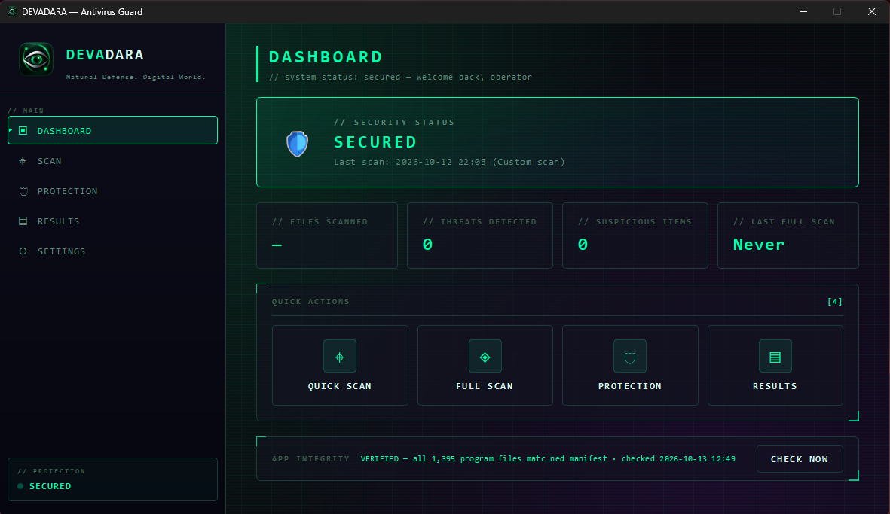
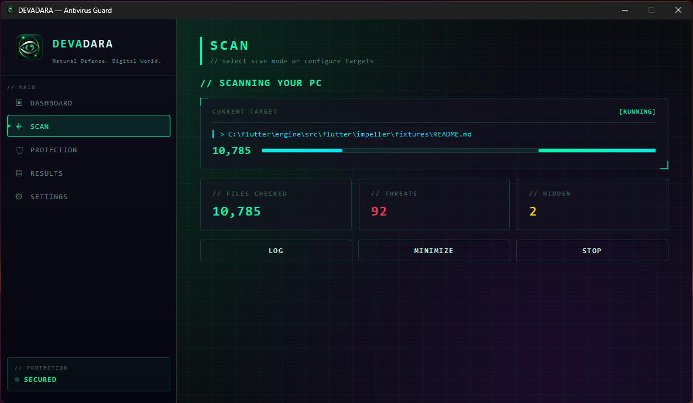
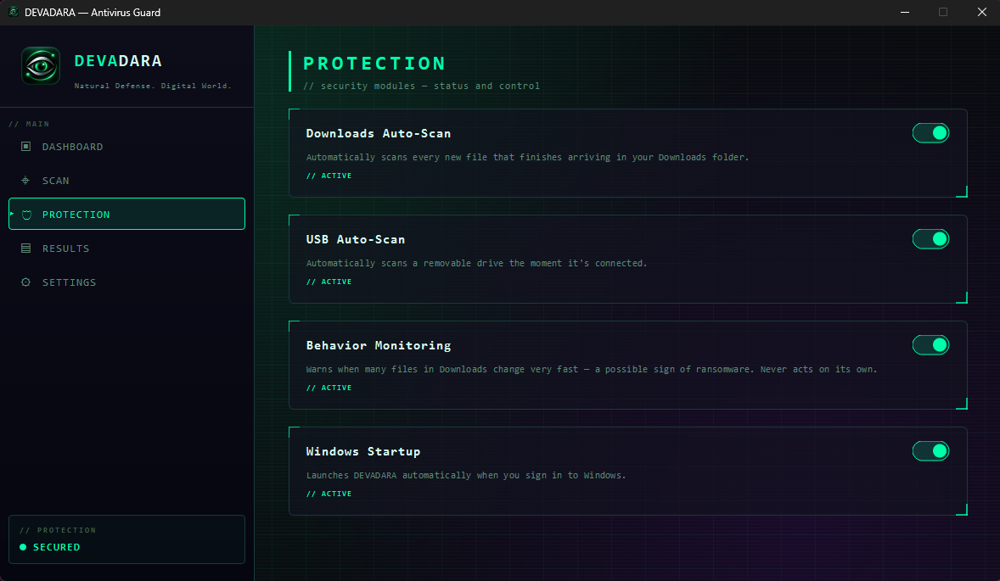
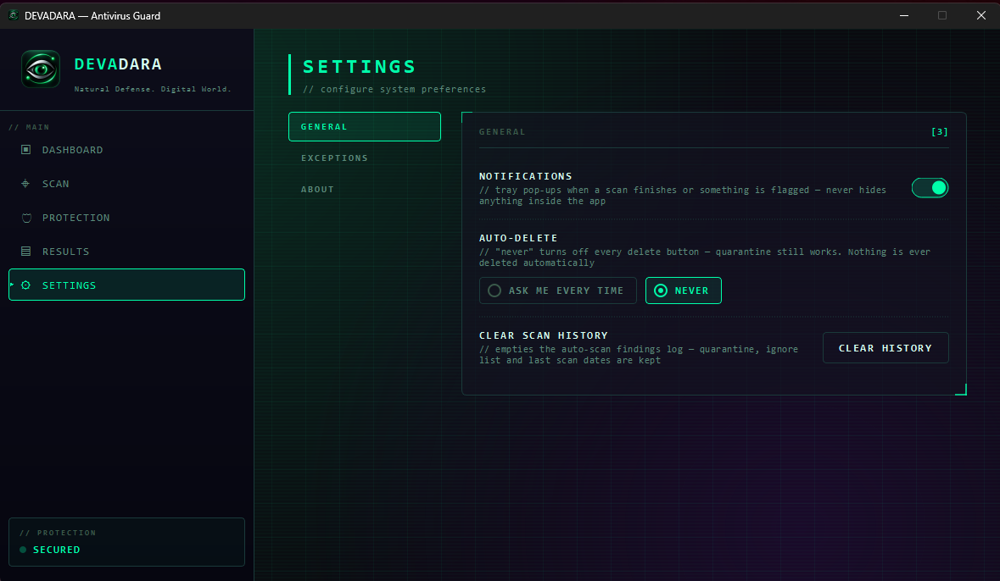

# DEVADARA

An offline, privacy-first antivirus for Windows 10/11 (64-bit). A personal portfolio project.

## Download

**Latest release: v1.0.0** (zip, about 115 MB)

[DEVADARA-1.0.0-win64.zip](https://github.com/chavindujayawardhana-pixel/devadara-releases/releases/download/v1.0.0/DEVADARA-1.0.0-win64.zip)

SHA256: `53D1A6619FDA540E93E1213CC9053A81AD29C83D856D99F46BA57B09667BA865`

Right-click the zip and choose Extract All first. Do not run it from inside the zip. Then run `DEVADARA.exe` inside the extracted folder. Nothing needs to be installed.

## Screenshots

**Dashboard.** Shows the protection status, the last scan and the app's integrity check.



**Scan in progress.** Shows the file being checked right now and live counts.



**Protection.** Each background watcher can be switched on or off.



**Settings.** Here auto-delete is set to "Never", so every delete button is disabled.



## Why I built it

I'm an IT student from Sri Lanka. I wanted to learn how antivirus tools really work, so I built one that runs fully offline and never uploads your files. It is a learning project and a portfolio piece, not a replacement for a full antivirus product.

## Features

Every file goes through the same four checks, in this order:

1. **Hash check.** The app compares the file's SHA256 hash with a list of known-bad hashes. The list that ships is tiny (just the harmless EICAR test file). It grows on your PC each time you confirm a threat by quarantining it.
2. **YARA rules.** A bundled YARA engine scans every file type, including scripts and documents. There are a few starter rules (packers, process-injection hints, ransomware-note text, suspicious PowerShell, an EICAR test).
3. **Digital signature check.** Windows checks the Authenticode signature on executables. A fully valid, trusted signature skips the ML step. This avoids false alarms on real software.
4. **Local ML model.** A Random Forest model that runs on your PC. It looks at 52 fields from the header of an executable and gives a score: High Risk, Suspicious (needs a human look), or not flagged.

Other features:

- **Scan modes.** Quick Scan (executables only), Full Scan, Downloads, USB, or a custom set of folders.
- **Startup and system areas.** Checks registry Run keys, scheduled tasks and auto-start services, and runs their target files through the same checks.
- **Running processes.** Looks for simple warning signs, such as a program running from an odd folder or a document app starting a command shell.
- **Hidden files.** Lists hidden files found during a scan. You can unhide them.
- **Quarantine.** Encrypts a flagged file and moves it away. You can restore it at any time.
- **Downloads auto-scan.** Scans each new file once it has fully finished downloading.
- **USB auto-scan.** Scans a removable drive as soon as it is plugged in.
- **Behavior monitoring.** Watches your Downloads folder. If 20 or more file changes happen within 5 seconds, it shows a warning that this *may* be ransomware-like activity. It also makes a best guess at which program has files open there. It never acts on its own. You can suspend or stop a listed program, but only after you confirm. Windows' own system processes are protected.
- **Self-integrity check.** The app checks its own program files against a manifest signed with Ed25519. That way it can notice if its rules, model or other files have been changed or swapped.
- **Optional start with Windows.** Uses a per-user startup entry. At sign-in it runs a background scan that only logs and notifies.

## How it works

DEVADARA borrows its idea from the human immune system:

- **Memory cells.** Hash and signature matching recognise things already known to be bad (or known to be trusted).
- **Pattern recognition.** The local ML model judges files it has never seen before by their structure.
- **Adaptive memory.** Each threat you confirm is added to a local hash database, so the app recognises it straight away next time.

## Built with

Python, PySide6 (desktop UI), scikit-learn (Random Forest model), YARA, PyInstaller (packaging), and Ed25519 signatures (self-integrity check).

## Privacy and safety

- **Runs 100% on your PC.** There is no cloud, no account, and no telemetry. The app never uploads your files.
- **Never auto-deletes.** Every action (quarantine, restore, delete, stopping a program) needs your click in a confirmation dialog, and Cancel is the default. To delete permanently you must type `DELETE`.
- **You can turn delete off.** Set auto-delete to "Never" in Settings and all delete buttons are disabled. Quarantine and restore still work.
- **Background scans only report.** They log what they find and notify you. They never act on their own.

## Windows SmartScreen and verifying the download

DEVADARA is not signed with a paid code-signing certificate. Windows SmartScreen may therefore show **"Windows protected your PC"** or **"Unknown publisher"**. To run it anyway, click **More info → Run anyway**.

Before you do that, check that the zip you downloaded is the real one. In PowerShell:

```powershell
Get-FileHash .\DEVADARA-1.0.0-win64.zip -Algorithm SHA256
```

The hash should be:

```
53D1A6619FDA540E93E1213CC9053A81AD29C83D856D99F46BA57B09667BA865
```

If it does not match, do not run the file.

Note: the app's own Ed25519 self-integrity check is **not** the same as a Windows code-signing certificate. It helps the app spot its own files being changed, but Windows does not use it to decide whether to trust the app.

## Known limitations

- In my own test on a developer PC, v1.0 marked many development-tool files (for example Flutter, Android SDK and Git files) as High Risk. These were false alarms. Please review results before you quarantine anything.
- So far I have only tested it on my own PC.
- The ML model is trained once and bundled. It does not update itself.
- The shipped list of known-bad hashes is very small. Detection relies mostly on YARA rules, signatures and the ML model.
- Behavior monitoring watches only the Downloads folder. Its guess about which program caused the changes is best-effort and can be empty.
- It is not a replacement for Microsoft Defender or other full antivirus products.

## Roadmap (not built yet)

- Settings → Exceptions: a way to manage ignored files and folders
- Scanning inside archives (zip and others)

## About the author

**Chavindu Jayawardana**, Sri Lanka

- Website: [chavindujayawardana.com.lk/devadara](https://www.chavindujayawardana.com.lk/devadara)
- LinkedIn: [Chavindu Jayawardana](https://www.linkedin.com/in/chavindu-jayawardana-81a57a334)
